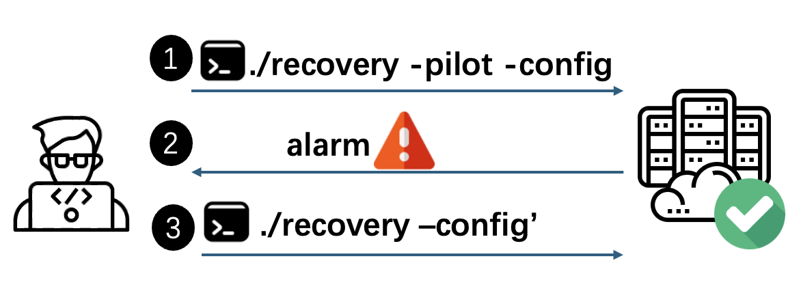

# Artifact Evaluation (AE) for NSDI'26 Fall #6

**"Pilot Execution: Simulating Failure Recovery In Situ for Production Distributed Systems"**

---

## Artifact Goals

We claim the following badges for the paper:

### Artifact Available
This artifact provides a proof-of-concept implementation and demonstrates a minimal working example for detecting Solr-17515.

The repository contains two parts:

| Component                    | Description                                              | Path                  |
| ---------------------------- | -------------------------------------------------------- | --------------------- |
| PILOT Instrumentation Engine | Transforms bytecode of systems to enable pilot execution | `PilotExecution/src`  |
| PILOT Runtime Lib            | Manages pilot runs at runtime                            | `PilotExecution/Pilot`|

### Artifact Functional

The artifact is functional. We demonstrate how to transform Solr automatically from scratch to enable pilot execution and detect [SOLR-17515](https://issues.apache.org/jira/browse/SOLR-17515) in evaluation.

### Artifact Reproducible

Due to time constraints, it is difficult for us to make the whole evaluation automatic with scripts, so we have tried our best to provide automatic scripts to demonstrate that our tool is functional.

> If you have any questions, please contact us via email or HotCRP.

---

## 1. Prerequisites for PILOT

### Setting Up CloudLab Machines

If you are a first-time user of CloudLab, we encourage you to read the [CloudLab documentation](https://docs.cloudlab.us/repeatable-research.html#%28part._aec-members%29) on how AE is generally conducted on CloudLab.

If you do not have a CloudLab account, please apply for one following this [link](https://www.cloudlab.us/signup.php), and ask the NSDI AEC chair to add you to the NSDI AEC project. Please let us know if you have trouble accessing CloudLab—we can help set up the experiment and give you access.

To show that PILOT is functional on Solr (which is a distributed system), we need a three-node cluster. We provide the [PILOT-cloudlab](https://www.cloudlab.us/p/SilentFailure/PILOT-cloudlab) (CloudLab Profile) for you to evaluate it, and each node is already configured with the dependencies.

> [!IMPORTANT]
> The machines may not be available at all times. You would need to submit a resource reservation to guarantee the availability of the resources.

---

## 2. Setup the Environment with the Profile

We provide the CloudLab profile to automatically start a three-node cluster (hostnames: `node0`, `node1`, `node2`) for you.

To use the profile:

1. Follow the [link](https://www.cloudlab.us/instantiate.php?profile=40a9027c-d712-11f0-bc80-e4434b2381fc&from=manage-profile) and keep hitting **Next** to create the experiment.
2. Access the machines using SSH provided by the CloudLab Web UI.

Please proceed to the **Kick-the-Tire Instructions** to validate.

---

## 3. Kick-the-Tire Instructions for PILOT (~5 min)

In this example, we will:

- Build the PILOT runtime library and PILOT instrumentation engine
- Set up a Zookeeper cluster (used as status registry during pilot run)

### 3.1 Set Up Java Environment

Make sure you set JDK to openjdk-8. You should also set the `JAVA_HOME` environment variable properly (and add it to `.bashrc`).

SSH into `node0`, `node1`, `node2` and run:

```bash
export JAVA_HOME=/usr/lib/jvm/java-8-openjdk-amd64
echo 'export JAVA_HOME=/usr/lib/jvm/java-8-openjdk-amd64' >> ~/.bashrc

export PATH="/usr/lib/jvm/java-8-openjdk-amd64/bin:$PATH"
echo 'export PATH="/usr/lib/jvm/java-8-openjdk-amd64/bin:$PATH"' >> ~/.bashrc
```

You should confirm it is set correctly:

```bash
echo $JAVA_HOME
# Expected output: /usr/lib/jvm/java-8-openjdk-amd64
```

> [!IMPORTANT]
> The remaining steps must be performed on `node0` only.

---

### 3.2 Build PILOT Instrumentation Engine (~2 min)

SSH into `node0` and run:

```bash
cd ~ && git clone -b main --recurse-submodules https://github.com/LiftLab-UVA/PilotExecution

cd ~/PilotExecution
chmod +x clone_build.sh
./clone_build.sh instrumentationengine
```

You should see `All tasks completed` after completion.

### 3.3 Build PILOT Runtime Library (~1 min)

```bash
./clone_build.sh runtimelib
```

You should see `BUILD SUCCESS` after completion.

### 3.4 Deploy Zookeeper

```bash
cd ~/PilotExecution/experiments/zookeeper_setup/
./setupzookeeper.sh
```

You should see `ZooKeeper Cluster Deployment Completed` indicating deployment success.

---

## 4. Full Evaluation (~40 min)
> [!IMPORTANT]
> Full Evaluation must be performed on `node0` only and after completing all the steps in **Kick-the-Tire Instructions**.

---

The usage of pilot execution is as follows: after transforming the source code of the system with the PILOT tool, the operator can use a pilot run to try their recovery strategy. If the pilot run succeeds, the operator performs the real recovery. If it is not successful, they can analyze the feedback, fix the issue, and then perform the correct recovery.



SSH into `node0` and run:


### 4.1 Build Solr (~9 min 30 s)

This step will compile Solr source code from the Apache website and integrate the PILOT runtime library into Solr's compiled output.

```bash
cd ~/PilotExecution/experiments/solr17515/managesolr
./build_solr.sh
```

You should see `Build and Deploy Completed` after completion.

### 4.2 Instrument Solr and Generate the Executable Package (~5 min)

```bash
cd ~/PilotExecution/experiments/solr17515
./generate_original.sh && ./instrument_pilot.sh
```

This step instruments Solr and repackages it to make it executable with pilot execution enabled. You should see output like `Update task completed`.

### 4.3 Reproduce Solr-17515 on Buggy Version Code

To reproduce Solr-17515 (https://issues.apache.org/jira/browse/SOLR-17515) in the paper, we let one node in the Solr cluster fail, and it will be recovered by an operator who manually inputs a recovery command, letting the failed node sync with the alive one to recover and rejoin the cluster.

#### 4.3.1 Inject the Bug (~1 min 30 s)

```bash
cd ~/PilotExecution/experiments/solr17515
./reproduce.sh bug
```

This injects the bug to create the bug scenario in Solr-17515. You should see output like `Done`.

#### 4.3.2 Trigger Pilot Execution

```bash
cd ~/PilotExecution/experiments/solr17515
./execute_recovery.sh pilot
```
> **Note:** We provide `execute_recovery.sh` to wrap the real recovery command for easier input. The original recovery command of Solr is printed on the console if you are interested.

Because this is the buggy version, pilot execution fails and provides you with feedback including error information and the constructed context tree for you to trace recovery.

The format of each node in the context tree is `([hostname] functionname (threadId, Timestamp))`, where each element represents: hostname, function name, thread ID, and timestamp. (Due to space limits, only part of the context tree is shown.)

```
========================================
     PILOT execution results
========================================

Error detected
2025-12-14 20:18:57.295 ERROR (recoveryExecutor-11-thread-1-processing-n:10.10.1.2:8983_solr x:mycollection_shard1_replica_n1 c:mycollection s:shard1 r:core_node3) [c:mycollection s:shard1 r:core_node3 x:mycollection_shard1_replica_n1] o.a.s.c.RecoveryStrategy Error while trying to recover. core=mycollection_shard1_replica_n1 => java.lang.NullPointerException
at org.apache.solr.cloud.RecoveryStrategy.injectFault$instrumentation(RecoveryStrategy.java:181)
java.lang.NullPointerException: null
at org.apache.solr.cloud.RecoveryStrategy.injectFault$instrumentation(RecoveryStrategy.java:181) ~[?:?]
at org.apache.solr.cloud.RecoveryStrategy.buildRecoverySolrClient$instrumentation(RecoveryStrategy.java) ~[?:?]
at org.apache.solr.cloud.RecoveryStrategy.sendPrepRecoveryCmd$instrumentation(RecoveryStrategy.java:881) ~[?:?]

========================================
context tree is
========================================

[pilotexecution] ROOT (tid=0, ts=0)
├── [node1] getCore$instrumentation (tid=64, ts=1765743537156)
│   └── [node1] getCore$instrumentation (tid=64, ts=1765743537157)
│       └── [node1] getCoreFromAnyList$instrumentation (tid=64, ts=1765743537194)
│           └── [node1] open$instrumentation (tid=64, ts=1765743537195)
│               ├── [node1] getCoreContainer$instrumentation (tid=64, ts=1765743537195)
│               ├── [node1] getCoreDescriptor$instrumentation (tid=64, ts=1765743537195)
│               ├── [node1] getZkController$instrumentation (tid=64, ts=1765743537195)
│               │   └── [node1] getZkController$instrumentation (tid=64, ts=1765743537195)
│               ├── [node1] getNodeName$instrumentation (tid=64, ts=1765743537195)
│               ├── [node1] getName$instrumentation (tid=64, ts=1765743537196)
│               ├── [node1] getCloudDescriptor$instrumentation (tid=64, ts=1765743537196)
│               ├── [node1] getCollectionName$instrumentation (tid=64, ts=1765743537196)
│               ├── [node1] getShardId$instrumentation (tid=64, ts=1765743537196)
│               └── [node1] getCoreNodeName$instrumentation (tid=64, ts=1765743537196)
├── [node1] getUpdateHandler$instrumentation (tid=64, ts=1765743537197)
├── [node1] getSolrCoreState$instrumentation (tid=64, ts=1765743537197)
├── [node1] getCoreDescriptor$instrumentation (tid=64, ts=1765743537197)
├── [node1] doRecovery$instrumentation (tid=64, ts=1765743537197)
│   ├── [node1] initiatedFromPilotRun$instrumentation (tid=64, ts=1765743537197)
│   ├── [node1] getUpdateShardHandler$instrumentation (tid=64, ts=1765743537200)
│   ├── [node1] getUpdateExecutor$instrumentation (tid=64, ts=1765743537200)
│   └── [node1] run$instrumentation (tid=65, ts=1765743537210)
│       ├── [node1] getZkController$instrumentation (tid=65, ts=1765743537210)
│       │   └── [node1] getZkController$instrumentation (tid=65, ts=1765743537210)
│       ├── [node1] getNodeName$instrumentation (tid=65, ts=1765743537210)
│       ├── [node1] getName$instrumentation (tid=65, ts=1765743537211)
│       ├── [node1] getCloudDescriptor$instrumentation (tid=65, ts=1765743537211)
...
```

#### 4.3.3 Operator Performs Minor Tweaks to Make Recovery Work

The root cause of Solr-17515 is an incorrect configuration. The operator could perform minor tweak to the configuration so that the recovery could work. We provide a script to simulate this:

```bash
cd ~/PilotExecution/experiments/solr17515
./tweak_conf.sh
```

#### 4.3.4 Perform Normal Recovery (After the Minor Tweaks)

```bash
./execute_recovery.sh normal
```

The minor tweak could make normal recovery work even if the code is still buggy. The output is like:

```
========================================
     NORMAL execution results
========================================

Recovery successful:
2025-12-14 20:22:24.901 INFO  (recoveryExecutor-11-thread-2-processing-n:10.10.1.2:8983_solr x:mycollection_shard1_replica_n1 c:mycollection s:shard1 r:core_node3) [c:mycollection s:shard1 r:core_node3 x:mycollection_shard1_replica_n1] o.a.s.c.RecoveryStrategy Finished recovery process, successful=[true]
```

### 4.4 Reproduce Solr-17515 on Fixed Version Code

After Solr-17515 was reported, the developer pushed a new commit to fix it so that recovery would always succeed without needing minor tweaks. This means pilot execution will be successful. We provide a script to modify the code to the fixed version, which means no recovery bug exists.

#### 4.4.1 Apply the Fix (~1 min 30 s)

```bash
cd ~/PilotExecution/experiments/solr17515
./reproduce.sh fix
```

This creates the scenario where recovery is needed, the same as above, but on the correct version of the code. You should see output like `Done`.

#### 4.4.2 Trigger Pilot Execution

```bash
cd ~/PilotExecution/experiments/solr17515
./execute_recovery.sh pilot
```

This time pilot execution is successful. The output is like:

```
========================================
     PILOT execution results
========================================

Recovery successful:
2025-12-14 20:24:58.731 INFO  (recoveryExecutor-11-thread-1-processing-n:10.10.1.2:8983_solr x:mycollection_shard1_replica_n1 c:mycollection s:shard1 r:core_node3) [c:mycollection s:shard1 r:core_node3 x:mycollection_shard1_replica_n1] o.a.s.c.RecoveryStrategy Finished recovery process, successful=[true]

========================================
context tree is
========================================
...
```

To see the evidence that pilot execution is isolated, you can run the following command to see that pilot execution I/O is all redirected to /opt/ShadowDirectory. The output is like:

```bash
cd ~/PilotExecution/experiments
./print_shadow_file.sh
```

```
/opt/ShadowDirectory
└── opt
    └── SolrData
        ├── filestore
        ├── mycollection_shard1_replica_n1
        │   ├── core.properties
        │   └── data
        │       ├── index
        │       │   ├── _0.fdm
        │       │   ├── _0.fdt
        │       │   ├── _0.fdx
        │       │   ├── _0.fnm
        │       │   ├── _0.kdd
...
```

#### 4.4.3 Perform Normal Recovery

After the successful pilot execution, the operator can perform the real recovery:

```bash
cd ~/PilotExecution/experiments/solr17515
./execute_recovery.sh normal
```

The output is:

```
========================================
     NORMAL execution results
========================================

Recovery successful:
2025-12-14 20:28:07.227 INFO  (recoveryExecutor-11-thread-2-processing-n:10.10.1.2:8983_solr x:mycollection_shard1_replica_n1 c:mycollection s:shard1 r:core_node3) [c:mycollection s:shard1 r:core_node3 x:mycollection_shard1_replica_n1] o.a.s.c.RecoveryStrategy Finished recovery process, successful=[true]
```